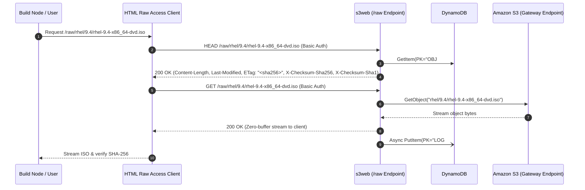
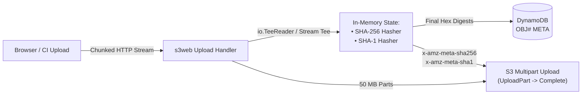

# System Design Document: `s3web` — Large File Archive Frontend for AWS S3 Intelligent-Tiering

## 1. Overview & Objectives

`s3web` is an internal web interface, large file archive frontend, and HTTP data-plane proxy for Amazon S3 buckets with AWS S3 Intelligent-Tiering. Designed for multi-gigabyte files (ISO images, virtual machine disk images, database backups, tarballs, and compressed archives: `.iso`, `.img`, `.raw`, `.tar.gz`, `.tgz`, `.zip`, `.qcow2`, `.vmdk`, and datasets), it combines the architectural strengths of three reference projects while solving the enterprise requirements they leave unaddressed:
1. [`wenisch-tech/s3webui`](https://github.com/wenisch-tech/s3webui) — Modern Tailwind + Lucide UI, OIDC/local auth, and application-level audit history.
2. [`aws-samples/sample-amplify-storage-browser`](https://github.com/aws-samples/sample-amplify-storage-browser) — Clean prefix/location drill-down, RBAC permissions (`READ` vs. `READWRITE`), and resilient client-side multipart uploads.
3. [`aws-samples/public-file-browser-for-amazon-s3`](https://aws.amazon.com/blogs/storage/creating-a-simple-public-file-repository-on-amazon-s3/) — Apache/Nginx `autoindex`-style browsable directory repository index and S3 event-driven synchronization so files dropped directly into the S3 bucket immediately appear in the repository index.

### Core Requirements
1. **Private VPC Capable & Zero External CDN Dependencies (VPN Access Only)**:
   - Hosted in an isolated AWS VPC containing **only private subnets** (no Internet Gateway, no public subnets, and no public IP addresses), accessed exclusively via a corporate **VPN (Virtual Private Gateway / AWS Transit Gateway / Client VPN)**.
   - Built with **zero external CDN dependencies** (`//go:embed` self-contained UI with inline SVG assets; no runtime internet access or external fonts/scripts required).
   - All AWS service dependencies (`S3`, `DynamoDB`, `ECR`, `CloudWatch Logs`, `Secrets Manager`, `SQS`, `KMS`) are reached via **VPC Gateway and Interface Endpoints (AWS PrivateLink)**.
2. **Authentication & In-App RBAC (Zero Anonymous Access)**:
   - **Anonymous Access Disabled**: Every request to `/api/v1/*` and `/raw/*` requires authentication (Session Cookie, HTTP Basic Auth, or Bearer Token/JWT).
   - **Local User Accounts (`LOCAL_USER`)**: Built-in local accounts stored with PBKDF2-SHA256 salted password hashes. On initial install, `s3web` automatically creates a default `admin` account with a cryptographically random generated password and a `demo` local user account. Local users can update their own passwords, and administrators can reset passwords or disable individual or all local accounts.
   - **Human Users (Multi-SSO)**: Multiple OIDC / OAuth 2.0 SSO providers (Okta, Microsoft Entra ID, Keycloak, or AWS IAM Identity Center) configurable in Settings and reachable over the VPN/private network.
   - **CI Workflows (Multi-JWT Workload Identity / OIDC JWT)**: Multiple configurable OIDC JWT issuers (e.g., GitHub Actions, GitLab CI, Buildkite) validated against cached/pinned JWKS keys, `iss`, `aud`, and `exp`, and matched against repository/branch/environment claims.
   - **Service Accounts**: Scoped machine credentials created under Settings supporting HTTP Basic Auth and Bearer tokens for HTML Raw Access and internal automation.
   - **In-App Permission Management**: All **Upload**, **Delete**, and **Admin** permissions are configured and managed directly inside the `s3web` application UI (stored in DynamoDB / local store). Default access for authenticated human users is **Read-Only**, and administrators can grant **Upload** and/or **Delete** permissions (globally or scoped to specific bucket prefixes) to any SSO Group, App-Managed Group, individual SSO User, Local User, CI Workflow identity (`repo:org/repo:ref:...`), or Service Account.
3. **HTML Raw Access Compatibility**: Serves as an upstream remote target for a **HTML Raw Access** (as well as an HTML directory index similar to `public-file-browser-for-amazon-s3`), supporting `GET`, `HEAD`, `ETag`, `Last-Modified`, HTTP `Range` requests, and virtual `.sha256` / `.sha1` checksum sidecar files.
4. **Full-File Linear Hashes (`SHA-256` & `SHA-1`)**: Every object exposes verified full-file `SHA-256` and `SHA-1` digests in the Web UI, API responses, HTTP headers, and sidecar endpoints.
5. **S3 Intelligent-Tiering Visibility & Restore Workflow**: The S3 bucket uses **S3 Intelligent-Tiering** (`INTELLIGENT_TIERING`). The UI displays the exact access tier each object currently resides in (**Frequent Access**, **Infrequent Access**, **Archive Instant Access**, **Archive Access**, or **Deep Archive Access**), tracks tier transitions automatically via S3 events/HeadObject, and provides one-click asynchronous restoration (`RestoreObject`) if an object has transitioned to an asynchronous archive tier.
6. **Per-Item Access Logs**: Real-time, item-specific access history viewable directly in the Web UI showing every download, upload, delete, or archive-restore event alongside the principal (SSO user, GitHub workflow, or service account), IP address, User-Agent, and bytes transferred.
7. **File Extension Limiting (Upload Whitelist)**: Administrators can enforce allowed file extension policies at the repository level (`S3WEB_ALLOWED_EXTENSIONS` or Settings UI) and per In-App Access Grant. Multi-part extensions (`.tar.gz`, `.tar.bz2`) and standard archive formats are supported, with immediate rejection (`400 Bad Request`) for disallowed uploads.

---

## 2. Reference Architecture Comparison

| Capability | `public-file-browser-for-amazon-s3` (AWS Storage Blog) | `sample-amplify-storage-browser` | `wenisch-tech/s3webui` | `s3web` (This Design) |
| :--- | :--- | :--- | :--- | :--- |
| **Primary UI Pattern** | Classic "file repository" directory tree (`autoindex` style) for downloading public artifacts | React Storage Browser component with prefix locations, search, and multipart upload manager | Tailwind CSS + Alpine.js + Lucide icons with dark/light mode, search, and audit logs | **Hybrid Artifact Repository UI**: Fast `autoindex`-style directory repository table + Tailwind/Lucide design + inline hash badges + slide-over per-item audit drawer |
| **Network Topology** | Public CloudFront CDN + S3 Static Website | Public Cognito + direct browser-to-S3 SDK calls | Self-hosted container (Spring Boot) | **Private-Only VPC (Private Subnets Only via VPN)** + Internal ALB + ECS Fargate + VPC Gateway/Interface Endpoints |
| **Authentication** | Anonymous / Cognito Identity Pool (Public Read-Only) | Cognito / IAM Identity Center issuing temporary STS credentials | Local users + OIDC SSO + in-app IAM/group rules | **OIDC SSO + GitHub Actions OIDC JWT + Service Accounts + In-App Permission Management** |
| **HTML Raw Access** | Works only if public/unauthenticated via CloudFront; no virtual checksum sidecars | Unsupported (browser-only AWS SigV4 SDK calls) | Not designed for upstream repository proxying | **Dedicated `/raw/{key...}` HTTP proxy & HTML `autoindex` endpoint** with Basic/Bearer Auth, `HEAD`, `Range`, and `.sha256`/`.sha1` sidecars |
| **Multi-GB ISO Checksums** | None (size & timestamp only) | Exposes S3 `ETag` only (composite `md5-partCount` on multipart uploads) | Exposes standard S3 object metadata | **Streaming linear `SHA-256` + `SHA-1`** computed during upload (and via S3 Event async worker for out-of-band uploads) |
| **Intelligent-Tiering Visibility** | None | Shows top-level `StorageClass` only (does not show sub-tier `x-amz-archive-status`) | Shows top-level `StorageClass` only | **Full S3 Intelligent-Tiering sub-tier badge** (`FA`, `IA`, `AIA`, `AA`, `DAA`) + restore status & UI trigger |
| **Per-Item Access History** | CloudFront / S3 Access Logs only (not in UI) | External CloudTrail / S3 Server Logs only | Global application audit trail | **Real-time per-item access log** stored in DynamoDB (`LOG#<object_key>`) viewable in each file's UI detail drawer |

---

## 3. Private-Only AWS VPC Infrastructure Architecture (VPN Access Only)

### 3.1 Strictly Private Subnets (No Public Subnets / No Internet Gateway Required)
The VPC contains **only private subnets** across multiple Availability Zones. Inbound access from corporate users, HTML Raw Access, and self-hosted GitHub Actions runners enters the VPC exclusively through a **Virtual Private Gateway (VGW) / AWS Transit Gateway (TGW) / AWS Client VPN** terminating into the private route tables.
- **Load Balancing**: An `internal`-scheme **Application Load Balancer (ALB)** deployed in the private subnets terminates TLS (`:443`) using a private/ACM certificate and resolves via **Route 53 Private Hosted Zone** (with an Inbound Resolver Endpoint if queried from on-prem DNS over VPN).
- **Required VPC Endpoints for Private-Only ECS Fargate Operation**:
  Because there are no public subnets or Internet Gateways, the VPC uses:
  1. **Gateway VPC Endpoints** (Free, route-table attached):
     - `com.amazonaws.<region>.s3` (for S3 bucket streaming & ECR image layer pulls)
     - `com.amazonaws.<region>.dynamodb` (for metadata, hashes, access logs, and in-app permissions)
  2. **Interface VPC Endpoints / AWS PrivateLink** (for ECS Fargate control plane & background events):
     - `com.amazonaws.<region>.ecr.api` & `com.amazonaws.<region>.ecr.dkr` (pulling container images privately)
     - `com.amazonaws.<region>.logs` (shipping container logs to CloudWatch Logs)
     - `com.amazonaws.<region>.secretsmanager` / `ssm` (injecting OIDC client secret & session encryption keys)
     - `com.amazonaws.<region>.sqs` (receiving S3 `ObjectCreated` events for out-of-band uploads)

### 3.2 Topology Diagram

```mermaid
flowchart LR
    subgraph Corp["Corporate Network / VPN Clients"]
        Browser["SSO & Local Users\n(Browser over VPN)"]
        RawClient["HTML Raw Access\n(CLI / Automation Client)"]
        GHA["GitHub Actions Runner\n(Self-Hosted on Private Net)"]
        IdP["OIDC IdP / GitHub Enterprise\n(Reachable via VPN or Private Route)"]
    end

    VPN["VPN Gateway\n(VGW / Transit Gateway / Client VPN)"]

    subgraph VPC["AWS VPC (Private Subnets Only — No IGW)"]
        R53["Route 53 Private DNS\n(s3web.internal.corp)"]
        ALB["Internal ALB\n(scheme: internal, TLS :443)"]
        subgraph Subnets["Private Subnets (Multi-AZ)"]
            subgraph ECS["ECS Fargate Cluster"]
                WebTask["s3web Service\n(Web UI + REST API + /raw Proxy)"]
                HashWorker["Background Hasher\n(Out-of-band S3 Event Consumer)"]
            end
        end
        S3GW["S3 Gateway\nVPC Endpoint"]
        DDBGW["DynamoDB Gateway\nVPC Endpoint"]
        VPCE["Interface VPC Endpoints\n(ECR, Logs, SQS, SecretsManager)"]
    end

    Browser -->|VPN Tunnel| VPN
    RawClient -->|VPN Tunnel| VPN
    GHA -->|VPN Tunnel| VPN

    VPN -->|HTTPS :443| ALB
    WebTask <-->|Token / JWKS via VPN| VPN
    VPN <--> IdP

    ALB --> WebTask
    WebTask --> S3GW
    HashWorker --> S3GW
    WebTask --> DDBGW
    HashWorker --> DDBGW
    ECS -.-> VPCE

    S3GW --> S3[("Amazon S3 Bucket\n(ISOs & Compressed Archives)")]
    DDBGW --> DDB[("Amazon DynamoDB\n(Metadata, Hashes, Access Logs, Permissions)")]
    S3 -.->|S3 ObjectCreated Events\n(SQS via PrivateLink)| HashWorker
```

### 3.3 Network & Security Lockdown for Private-Only Operation
- **Zero Public Exposure**: `s3web` has no public IP addresses, no public ALB, and no Internet Gateway path. All traffic originates from RFC 1918 / internal CIDR ranges routed over the VPN.
- **Zero-Cost S3 & DynamoDB Data Transfer**: Routing S3 and DynamoDB traffic through **Gateway VPC Endpoints** incurs **$0.00/hour and $0.00/GB charges**, enabling high-throughput multi-gigabyte ISO streaming between S3, ECS, and HTML Raw Access inside the private network.
- **S3 Bucket Policy Lockdown**: The S3 bucket policy (`BlockPublicAccess = true`) denies all `s3:*` actions unless `aws:SourceVpce` matches the VPC's S3 Gateway Endpoint ID and `aws:PrincipalArn` matches the ECS Task IAM Role.
- **Self-Contained Static Assets**: All frontend assets (Tailwind CSS, Alpine.js/React bundle, fonts, and Lucide SVG icons) are bundled directly inside the `s3web` container image—zero external CDN requests (`unpkg`, `jsdelivr`, Google Fonts) are made by the user's browser.

---

## 4. Authentication, Authorization, GitHub Actions JWT & Service Accounts

### 4.1 Authentication Flows

1. **Human Users — OIDC Authorization Code Flow with PKCE**:
   - Unauthenticated browser requests to `/` are redirected to `/auth/login` -> OIDC Provider.
   - Upon callback (`/auth/callback`), `s3web` validates the ID Token signature (via JWKS), extracts `sub`, `email`, `name`, and `groups` claims, and issues an encrypted `HttpOnly`, `Secure`, `SameSite=Lax` session cookie.
2. **GitHub Actions Workflows — Secretless OIDC JWT Authentication**:
   - GitHub Actions workflows running on self-hosted runners (with VPN/private network access to `s3web`) and `permissions: id-token: write` request an OIDC JWT from GitHub (`ACTIONS_ID_TOKEN_REQUEST_URL`) with audience `aud: https://s3web.internal.corp` and pass it directly as `Authorization: Bearer <eyJ...>`.
   - `s3web` verifies the JWT signature using GitHub's OIDC JWKS public keys (either fetched over the VPN/egress proxy or pinned/managed inside `s3web`'s In-App GitHub OIDC Trust store for completely air-gapped private subnets), verifies `iss`, `aud`, `exp`, and `nbf`, and extracts the workload claims:
     - `repository` (e.g., `my-org/os-image-builder`)
     - `ref` (e.g., `refs/heads/main`, `refs/tags/v*`)
     - `environment` (e.g., `production`)
     - `workflow_ref` & `actor` (recorded in per-item access logs for full traceability)
   - **Example GitHub Actions Workflow Step**:
     ```yaml
     jobs:
       publish-iso:
         runs-on: [self-hosted, vpn]
         permissions:
           id-token: write
           contents: read
         steps:
           - name: Fetch GitHub OIDC Token & Upload ISO to s3web over VPN
             run: |
               GH_JWT=$(curl -sLS -H "Authorization: Bearer $ACTIONS_ID_TOKEN_REQUEST_TOKEN" \
                 "$ACTIONS_ID_TOKEN_REQUEST_URL&audience=https://s3web.internal.corp" | jq -r '.value')
               curl --fail-with-body -X POST \
                 -H "Authorization: Bearer $GH_JWT" \
                 -T ./output/ubuntu-custom.iso \
                 "https://s3web.internal.corp/api/v1/objects/isos/ubuntu/ubuntu-custom.iso"
     ```
3. **Service Accounts & Local Accounts — HTTP Basic Auth & Static Bearer Tokens**:
   - HTML Raw Access authenticates using standard HTTP Basic Auth (`Authorization: Basic base64(username_or_service_account_id:secret)`), Bearer tokens (`Authorization: Bearer <id>:s3w_<token>`), or an authenticated session cookie.
   - Secrets and local account passwords are hashed at rest using **PBKDF2-HMAC-SHA256** (100,000 iterations with a 16-byte random salt). Successful verifications are cached in an in-memory TTL cache for 60 seconds to avoid repeated CPU overhead during rapid HTML Raw Access `HEAD`/`GET` bursts.

### 4.2 In-App Permission Management & Prefix-Scoped RBAC

Inspired by `wenisch-tech/s3webui`'s built-in IAM administration and `amplify-storage-browser`'s location access grants, **all Upload and Delete permissions are managed directly inside the `s3web` application** (persisted in DynamoDB) rather than relying on static environment variables or AWS IAM roles.

1. **Default Posture (`Read-Only`)**:
   - Every authenticated OIDC user defaults to **Read-Only** (`READ`: browse directories, view `SHA-256`/`SHA-1` hashes, view per-item access logs, and download artifacts).
2. **In-App Access Grants (Groups, Users, GitHub Workflows, and Service Accounts)**:
   - Inside the `s3web` Admin Console, administrators create **Access Grants** binding a **Subject** to fine-grained **Permissions** and **Bucket Prefixes**:
     - **Subject Types**:
       - `OIDC_GROUP`: Matches any group name present in the user's OIDC `groups` claim.
       - `APP_GROUP`: Matches an App-Managed Group created in `s3web` where admins add SSO users directly.
       - `SSO_USER`: Matches a specific user's OIDC email or `sub`.
       - `GITHUB_WORKFLOW`: Matches verified GitHub OIDC JWT claims using glob patterns on repository, ref, or environment (e.g., `repo:my-org/iso-builder:ref:refs/heads/main` or `repo:my-org/*:env:release`).
       - `SERVICE_ACCOUNT`: Matches an in-app Service Account (e.g., `svc-raw-access`).
     - **Granular Permission Flags** (independently toggleable per prefix rule):
       - `read`: Browse, `GET`/`HEAD` objects & checksums, view item access logs (enabled by default for all SSO users on `*`).
       - `upload`: Upload new ISOs/archives (`POST`/`PUT`) under matching prefixes.
       - `delete`: Delete existing objects (`DELETE`) under matching prefixes.
       - `admin`: Manage in-app permissions, groups, GitHub trust policies, and service accounts.

| Example In-App Rule | Subject Type | Subject Identifier / Claim Pattern | Prefix Scope | `read` | `upload` | `delete` | `admin` |
| :--- | :--- | :--- | :--- | :---: | :---: | :---: | :---: |
| Default Baseline | `BUILTIN` | `authenticated-users` | `*` | Yes | No | No | No |
| Release Engineering | `OIDC_GROUP` | `release-engineering` | `linux/*`, `isos/*` | Yes | **Yes** | No | No |
| Storage Curators | `APP_GROUP` | `iso-curators` | `*` | Yes | **Yes** | **Yes** | No |
| GitHub ISO Builder | `GITHUB_WORKFLOW` | `repo:my-org/iso-builder:ref:refs/heads/main` | `isos/nightly/*` | Yes | **Yes** | No | No |
| GitHub Release Tag | `GITHUB_WORKFLOW` | `repo:my-org/iso-builder:ref:refs/tags/v*` | `isos/releases/*` | Yes | **Yes** | No | No |
| HTML Raw Access | `SERVICE_ACCOUNT` | `svc-raw-access` | `*` | Yes | No | No | No |
| Platform Admins | `OIDC_GROUP` | `platform-admins` | `*` | Yes | **Yes** | **Yes** | **Yes** |

3. **Effective Permission Evaluation**:
   - On any request to a path `{key}`, `s3web` resolves all in-app grants matching the caller's identity (`user_id`, OIDC `groups`, `APP_GROUP`, `GITHUB_WORKFLOW` claim pattern, or `SERVICE_ACCOUNT`) whose prefix pattern matches `{key}`.
   - Permissions are **additive (union)**: if any matching rule grants `upload` (or `delete`) for that prefix, the action is permitted.
   - All changes to in-app permissions (granting/revoking upload or delete access) are themselves recorded in the audit log with the acting admin's identity.

---

## 5. HTML Raw Access Integration

### 5.1 How HTML Raw Access Connects
In HTML Raw Access Repository Manager v3:
- **Recipe**: `raw (proxy)`
- **Remote Storage URL**: `https://s3web.internal.vpc/raw/`
- **HTTP Authentication**: Username/Password using a `viewer` Service Account (e.g., `svc-raw-access`).

### 5.2 Request Lifecycle & Protocol Semantics



### 5.3 Checksum Headers, Virtual Sidecar Files & HTML Directory Index (`autoindex`)
Inspired by [`aws-samples/public-file-browser-for-amazon-s3`](https://aws.amazon.com/blogs/storage/creating-a-simple-public-file-repository-on-amazon-s3/), `/raw/` also acts as a clean, standards-compliant HTTP file repository index so HTML Raw Access (including its remote storage browser), `curl`, `wget -r`, or automated scripts can traverse directories natively:
1. **HTML Directory Index (`GET /raw/{prefix}/`)**:
   - When a request to `/raw/{prefix}/` ends with a trailing slash (or matches a known folder prefix), `s3web` renders a clean, minimal HTML `<pre>` directory listing (`Index of /raw/{prefix}/`) with relative `<a href="...">` links for every subfolder, file, `.sha256`, and `.sha1` sidecar, plus file size and last-modified timestamp.
2. **Response Headers on every `GET` / `HEAD` `/raw/{key...}`**:
   ```http
   HTTP/1.1 200 OK
   Content-Type: application/x-iso9660-image
   Content-Length: 10546872320
   Accept-Ranges: bytes
   Last-Modified: Thu, 05 Nov 2026 18:00:00 GMT
   ETag: "e3b0c44298fc1c149afbf4c8996fb92427ae41e4649b934ca495991b7852b855"
   X-Checksum-Sha256: e3b0c44298fc1c149afbf4c8996fb92427ae41e4649b934ca495991b7852b855
   X-Checksum-Sha1: da39a3ee5e6b4b0d3255bfef95601890afd80709
   ```
3. **Virtual Sidecar Endpoints**:
   - `GET /raw/{key}.sha256` -> Returns `200 OK` (`text/plain`) containing `<sha256>` (or `<sha256>  <filename>` with `?format=gnu`).
   - `GET /raw/{key}.sha1` -> Returns `200 OK` (`text/plain`) containing `<sha1>`.

---

## 6. Multi-GB ISO Hashing Pipeline (`SHA-256` & `SHA-1`)

### 6.1 The S3 Multipart Checksum Problem
Amazon S3's native checksums have two limitations for multi-gigabyte ISOs:
1. An S3 object can only store **one** native checksum algorithm (`SHA256` *or* `SHA1`), not both.
2. When uploaded via S3 Multipart Upload, S3's native checksum and `ETag` are computed as a **checksum-of-part-checksums** (`<digest>-<partCount>`), which does **not** match the standard full-file `sha256sum` or `sha1sum` of the ISO.

### 6.2 Dual-Hash Streaming Architecture



1. **In-Band Uploads (via Web UI or API)**:
   - All uploads specify `StorageClass = "INTELLIGENT_TIERING"` on `CreateMultipartUpload` / `PutObject` (and the bucket is configured with a default S3 Intelligent-Tiering configuration).
   - As bytes stream through `s3web` to S3 `UploadPart`, an in-memory stream splitter feeds each chunk simultaneously into `SHA-256` and `SHA-1` hash state machines.
   - Memory footprint per concurrent upload is strictly bounded to the part buffer size (e.g., 16–64 MB), regardless of whether the ISO is 4 GB or 50 GB.
   - When the stream finishes, `s3web` writes the final `sha256` and `sha1` hex strings and initial tier `archive_tier = "FREQUENT_ACCESS"` to DynamoDB, and attaches the hashes to the S3 object as user metadata (`x-amz-meta-sha256`, `x-amz-meta-sha1`).
2. **Out-of-Band Uploads (Direct to S3 Bucket)**:
   - If an object is uploaded directly to S3 outside `s3web`, an S3 `ObjectCreated:*` notification sends an event to SQS.
   - The `s3web` background worker sets `hash_status = "COMPUTING"` in DynamoDB, streams the object over the free S3 Gateway VPC Endpoint, calculates both `SHA-256` and `SHA-1`, writes the hashes to DynamoDB and S3 metadata, and updates `hash_status = "READY"`.

---

### 6.3 S3 Intelligent-Tiering Sub-Tier Tracking & Lifecycle

> [!NOTE]
> **How S3 Reports Intelligent-Tiering Sub-Tiers**:
> Standard `ListObjectsV2` only returns `StorageClass: "INTELLIGENT_TIERING"`—it does **not** distinguish between **Frequent Access (FA)**, **Infrequent Access (IA)**, and **Archive Instant Access (AIA)** unless tracked via access timestamps/S3 Inventory, and only returns `ArchiveStatus` (`ARCHIVE_ACCESS` or `DEEP_ARCHIVE_ACCESS`) when the optional Archive tiers are enabled. Furthermore, `HeadObject` returns `x-amz-archive-status` and `x-amz-restore` for archived objects.

`s3web` provides accurate, instant sub-tier visibility in the UI (`FA`, `IA`, `AIA`, `AA`, `DAA`) without calling `HeadObject` on every single row during directory listing by combining three signals in DynamoDB:

| Intelligent-Tiering Sub-Tier | UI Badge | Retrieval Latency | How `s3web` Resolves & Tracks the Tier |
| :--- | :--- | :--- | :--- |
| **Frequent Access** (`FA`) | `FA (Hot)` (Green) | Milliseconds | Default on upload (`StorageClass = INTELLIGENT_TIERING`) and automatically reset to `FA` whenever `s3web` streams a `GET` download (`last_accessed_at < 30 days`). |
| **Infrequent Access** (`IA`) | `IA (Warm)` (Blue) | Milliseconds | Object in `INTELLIGENT_TIERING` with no download for **30–90 consecutive days** (`last_accessed_at` tracked in DynamoDB + reconciled with S3 Inventory / `HeadObject`). |
| **Archive Instant Access** (`AIA`) | `AIA (Instant Archive)` (Indigo) | Milliseconds | Object in `INTELLIGENT_TIERING` with no download for **90+ consecutive days** (when asynchronous Archive tiers are not triggered). |
| **Archive Access** (`AA`) *(Optional)* | `Archive (Restore Req)` (Amber) | 3–5 hours (or Expedited 1–5 min) | Updated immediately via S3 `s3:IntelligentTiering` event notification (`x-amz-archive-status: ARCHIVE_ACCESS`) sent to the `s3web` SQS queue. |
| **Deep Archive Access** (`DAA`) *(Optional)* | `Deep Archive (Restore Req)` (Purple) | Within 12 hours | Updated immediately via S3 `s3:IntelligentTiering` event notification (`x-amz-archive-status: DEEP_ARCHIVE_ACCESS`) sent to the `s3web` SQS queue. |

#### Handling Archived Objects (`AA` / `DAA`) in the UI & HTML Raw Access
- **Synchronous Tiers (`FA`, `IA`, `AIA`)**: All three synchronous tiers have millisecond first-byte latency. Downloads from the UI or HTML Raw Access immediately stream the ISO and automatically transition the object back to **Frequent Access (`FA`)**, updating `intelligent_tier = "FA"` and `last_accessed_at = now()` in DynamoDB.
- **Asynchronous Archive Tiers (`AA`, `DAA`)**:
  - If the bucket has optional asynchronous Archive tiers enabled and an ISO transitions to `ARCHIVE_ACCESS` or `DEEP_ARCHIVE_ACCESS`, the UI displays an **`[Archived — Click to Restore]`** action button next to the tier badge.
  - Clicking **Restore** calls `POST /api/v1/objects/{key...}/restore` (`s3:RestoreObject`), updates the badge to `Restoring (Ongoing...)`, and when S3 emits `s3:ObjectRestore:Completed` to SQS, updates the badge to `Restored ( moves to FA)`.
  - If HTML Raw Access requests a `GET` on an un-restored `AA`/`DAA` object, `s3web` returns `409 Conflict` with `Retry-After` so the client knows the upstream artifact requires restoration first.

---

## 7. Data Model (Amazon DynamoDB Single-Table Design)

A single DynamoDB table (`s3web-metadata`) with On-Demand capacity and Time-To-Live (TTL) enabled stores object metadata, directory index entries, per-item access logs, local users, and service accounts.

### 7.1 Primary Table Schema (`PK` / `SK`)

| Entity Type | Partition Key (`PK`) | Sort Key (`SK`) | Attributes |
| :--- | :--- | :--- | :--- |
| **Object Metadata** | `OBJ#<object_key>` | `META` | `key`, `filename`, `parent_prefix`, `size` (Number), `content_type`, `storage_class` (`INTELLIGENT_TIERING`), `intelligent_tier` (`FA`\|`IA`\|`AIA`\|`AA`\|`DAA`), `restore_status` (`NONE`\|`IN_PROGRESS`\|`RESTORED`), `last_accessed_at`, `sha256`, `sha1`, `hash_status` (`READY`\|`COMPUTING`\|`FAILED`), `s3_etag`, `s3_version_id`, `uploaded_by`, `updated_at`, `download_count` (Atomic Counter) |
| **Directory Entry** | `DIR#<parent_prefix>` | `ENTRY#<type>#<name>` | `type` (`DIR`\|`FILE`), `name`, `key`, `size`, `intelligent_tier` (`FA`\|`IA`\|`AIA`\|`AA`\|`DAA`), `restore_status`, `sha256`, `sha1`, `hash_status`, `updated_at`, `last_accessed_at` |
| **Per-Item Access Log** | `LOG#<object_key>` | `TS#<iso8601_utc>#<req_id>` | `timestamp`, `action` (`DOWNLOAD`\|`UPLOAD`\|`DELETE`), `principal_type` (`LOCAL_USER`\|`SSO_USER`\|`GITHUB_WORKFLOW`\|`SERVICE_ACCOUNT`), `principal_id` (`admin`\|`alice@corp.com`\|`gh:my-org/iso-builder#run_9821`\|`svc-raw-access`), `groups`, `client_ip`, `user_agent`, `bytes_sent`, `status_code`, `range_request` (Boolean), `duration_ms`, `expires_at` (TTL) |
| **In-App Access Grant** | `GRANT#<subject_type>#<subject_id>` | `RULE#<rule_id>` | `subject_type` (`OIDC_GROUP`\|`APP_GROUP`\|`SSO_USER`\|`LOCAL_USER`\|`GITHUB_WORKFLOW`\|`SERVICE_ACCOUNT`), `subject_id`, `prefixes` (List, e.g., `["isos/*"]`), `can_read` (Bool), `can_upload` (Bool), `can_delete` (Bool), `is_admin` (Bool), `updated_by`, `updated_at` |
| **App-Managed Group** | `GROUP#<group_name>` | `MEMBER#<user_email>` | `group_name`, `user_email`, `added_by`, `added_at` (Allows grouping SSO/Local users directly in the app without IdP changes) |
| **Local User Account** | `USER#<username>` | `META` | `username`, `email`, `display_name`, `password_hash` (PBKDF2-SHA256), `is_admin` (Bool), `disabled` (Bool), `password_changed_at`, `last_login_at`, `created_by`, `created_at`, `updated_at` |
| **Service Account** | `SA#<account_id>` | `META` | `account_id`, `name`, `description`, `secret_hash` (PBKDF2-SHA256), `created_by`, `created_at`, `last_used_at`, `expires_at`, `revoked` (Boolean) |

### 7.2 Global Secondary Indexes (GSIs)
- **GSI1 (`GSI1PK` / `GSI1SK`) — Lookup by Hash & Global Audit Feed**:
  - **Checksum Lookup**: `GSI1PK = HASH#SHA256#<sha256>`, `GSI1SK = OBJ#<object_key>` (allows searching the UI by pasting a SHA-256 or SHA-1 hash).
  - **Principal Audit Lookup**: `GSI1PK = ACTOR#<principal_id>`, `GSI1SK = TS#<iso8601_utc>` (allows admins to view all activity by a specific user or service account).

---

## 8. Per-Item Access Logging Architecture

Why application-level logging instead of S3 Server Access Logs?
- **Latency**: S3 Server Access Logs take 15–120 minutes to appear; `s3web` logs appear in the UI in **< 50 ms**.
- **Identity Attribution**: S3 Server Access Logs only record the ECS Task IAM Role, whereas `s3web` records the exact OIDC user (`alice@example.com`) or Service Account (`svc-raw-access`).

### Logging Rules
1. **Download (`GET /raw/*` or `/api/v1/objects/*/download`)**:
   - Wrapped in a byte-counting response stream (`CountingResponseWriter`).
   - When the stream completes (or aborts), an asynchronous non-blocking worker writes the `LOG#<object_key>` record with the exact `bytes_sent`, HTTP status (`200` or `206 Partial Content`), `duration_ms`, `client_ip`, and `user_agent`, and increments `download_count` on `OBJ#<object_key>`.
2. **Noise Filtering**:
   - `HEAD` checks from HTML Raw Access are optionally excluded from the default UI table view (or toggled via a "Show HEAD checks" filter) so the access log stays focused on actual file downloads, uploads, and deletes.

---

## 9. Web User Interface & API Specification

### 9.1 Web UI Views

```
+----------------------------------------------------------------------------------------------------------+
|  s3web  |  Bucket: corp-iso-store (Intelligent-Tiering)  |  [Search filename / SHA...]  |  Alice (Admin) |
+----------------------------------------------------------------------------------------------------------+
|  Prefix:  root  /  linux  /  ubuntu  /  24.04                              [Filter Tier: All Tiers v]    |
|  [Refresh]  [Copy HTML Raw Access URL]                                    [+ Upload Artifact] (In-App)  |
+----------------------------------------------------------------------------------------------------------+
|  Name                                | Size     | IT Tier     | SHA-256        | SHA-1          | Actions|
|--------------------------------------+----------+-------------+----------------+----------------+--------|
|  [Folder] arm64/                     | --       | --          | --             | --             | --     |
|  [ISO] ubuntu-24.04.1-live-amd64.iso | 2.56 GB  | [FA - Hot]  | a8f4c2... [Cp] | 91b3e0... [Cp] | [DL]   |
|  [TAR] netboot-24.04.0-old.tar.gz    | 148.2 MB | [IA - 45d]  | 3d91e7... [Cp] | 44c1a8... [Cp] | [DL]   |
|  [ISO] ubuntu-22.04.1-legacy.iso     | 1.98 GB  | [AIA - 110d]| 7f02b1... [Cp] | 19a8c4... [Cp] | [DL]   |
|  [ISO] ubuntu-18.04-archive.iso      | 1.42 GB  | [AA - Arch] | 5c88e0... [Cp] | 88d1f2... [Cp] | [Rest] |
+----------------------------------------------------------------------------------------------------------+

  +-- Slide-Over Detail & Access Log Drawer: ubuntu-24.04.1-live-amd64.iso --------------------------------+
  |  Metadata, Intelligent-Tiering & Integrity Hashes                                                      |
  |  • Key:           linux/ubuntu/24.04/ubuntu-24.04.1-live-amd64.iso                                     |
  |  • Size:          2,748,779,069 bytes (2.56 GB)  |  Uploaded by: rel-eng@example.com                   |
  |  • Storage Class: INTELLIGENT_TIERING  ->  Current Sub-Tier: [Frequent Access (FA)] (Instant Retrieval)|
  |  • Last Accessed: 2026-11-05 19:35:02 UTC (Next tier transition to IA in 30 days if unaccessed)        |
  |  • SHA-256:       a8f4c29d18e4f01928374655a8f4c29d18e4f01928374655a8f4c29d18e4f019 [Copy] [.sha256]    |
  |  • SHA-1:         91b3e077f4a1b2c3d4e5f60791b3e077f4a1b2c3 [Copy] [.sha1]                              |
  |  • Verify CLI:    echo "a8f4c29d...  ubuntu-24.04.1-live-amd64.iso" | sha256sum -c                     |
  |                                                                                                        |
  |  Item Access Logs (Total Downloads: 42)                          [Actor: All v] [Action: All v] [CSV]  |
  |  Timestamp (UTC)      | Principal                   | Type      | Action   | Client IP  | Size         |
  |  2026-11-05 19:35:02  | svc-raw-access             | SERVICE   | DOWNLOAD | 10.24.4.19 | 2.56 GB (200)|
  |  2026-11-05 19:22:10  | bob@example.com             | SSO_USER  | DOWNLOAD | 10.24.11.8 | 2.56 GB (200)|
  |  2026-11-05 14:10:44  | my-org/iso-builder@main     | GH_ACTION | UPLOAD   | 10.24.8.41 | 2.56 GB (201)|
  +--------------------------------------------------------------------------------------------------------+

  +-- In-App Settings & Permissions Console ------------------------------------------------------+
  | [Buckets & Tree] [Local & Service Accounts] [Access Grants & Groups] [SSO] [JWT Issuers] [Storage] |
  |------------------------------------------------------------------------------------------------|
  |  Subject                                | Type       | Allowed Prefixes | Read | Upld | Del |Ad|
  |-----------------------------------------+------------+------------------+------+------+-----+--|
  |  All Authenticated Users                | BUILTIN    | *                | [x]  | [ ]  | [ ] |[ ]|
  |  release-engineering                    | OIDC_GROUP | linux/*, isos/*  | [x]  | [x]  | [ ] |[ ]|
  |  iso-curators                           | APP_GROUP  | *                | [x]  | [x]  | [x] |[ ]|
  |  repo:my-org/iso-builder:ref:refs/heads | GH_OIDC    | isos/nightly/*   | [x]  | [x]  | [ ] |[ ]|
  |  svc-raw-access                        | SVC_ACCT   | *                | [x]  | [ ]  | [ ] |[ ]|
  +------------------------------------------------------------------------------------------------+
```

### 9.2 HTTP Endpoint Specification

| Method & Path | Auth | Required Permission | Description |
| :--- | :--- | :--- | :--- |
| `POST /auth/login` | Public | None | Authenticates a local user account (`username`/`email` + `password`) and sets a signed `HttpOnly` session cookie |
| `POST /auth/logout` | Session | `read` | Clears session cookie |
| `POST /api/v1/auth/password` | Session / Basic | Local User | Allows any active local user account to update their own password |
| `GET /raw/{key...}` | Basic / Bearer / Session | `read` (on prefix) | Streams object, HTML `autoindex` directory, or `.sha256`/`.sha1` sidecar for HTML Raw Access & CLI |
| `HEAD /raw/{key...}` | Basic / Bearer / Session | `read` (on prefix) | Returns `Content-Length`, `Last-Modified`, `ETag`, `X-Checksum-Sha256`, `X-Checksum-Sha1` |
| `GET /api/v1/me` | Session / Bearer / Basic | `read` | Returns caller's principal and effective `read`/`upload`/`delete`/`admin` permissions |
| `GET /api/v1/browse?prefix=` | Session / Bearer / Basic | `read` (on prefix) | Lists folders and files at prefix with `intelligent_tier`, `restore_status`, `sha256`, `sha1`, `size`, and `updated_at` |
| `GET /api/v1/search?q=&tier=` | Session / Bearer / Basic | `read` (per key) | Searches items by filename prefix, Intelligent-Tiering sub-tier, or exact `SHA-256` / `SHA-1` digest |
| `GET /api/v1/objects/{key...}/meta` | Session / Bearer / Basic | `read` (on prefix) | Returns full metadata, Intelligent-Tiering sub-tier/archive status, and hashes for a single object |
| `GET /api/v1/objects/{key...}/download` | Session / Bearer / Basic | `read` (on prefix) | Streams direct object download with attachment disposition and per-item access logging |
| `POST /api/v1/objects/{key...}/restore` | Session / Bearer / Basic | `read` (on prefix) | Initiates `s3:RestoreObject` for items in `ARCHIVE_ACCESS` or `DEEP_ARCHIVE_ACCESS` tiers |
| `GET /api/v1/objects/{key...}/logs` | Session / Bearer / Basic | `read` (on prefix) | Paginated per-item access logs (`?limit=50&action=DOWNLOAD&actor=...`) |
| `POST /api/v1/objects/{key...}` | Session / Bearer / Basic | `upload` (on prefix) | Streams upload to S3 while computing linear `SHA-256` & `SHA-1` |
| `DELETE /api/v1/objects/{key...}` | Session / Bearer / Basic | `delete` (on prefix) | Deletes object from S3, removes directory entry, and writes `DELETE` access log |
| `GET /api/v1/admin/local-users` | Session / Basic | `admin` | Lists all local user accounts (with password hashes stripped) |
| `POST /api/v1/admin/local-users` | Session / Basic | `admin` | Creates a new local user account |
| `POST /api/v1/admin/local-users/disable-all` | Session / Basic | `admin` | Disables (or re-enables) all local user accounts immediately |
| `PUT /api/v1/admin/local-users/{username}/password` | Session / Basic | `admin` | Resets the password of any local user account and invalidates prior sessions |
| `PUT /api/v1/admin/local-users/{username}/status` | Session / Basic | `admin` | Enables or disables a specific local user account |
| `DELETE /api/v1/admin/local-users/{username}` | Session / Basic | `admin` | Deletes a local user account |
| `GET /api/v1/admin/grants` | Session / Basic | `admin` | Lists all in-app Upload/Delete/Admin Access Grants |
| `POST /api/v1/admin/grants` | Session / Basic | `admin` | Creates or updates an in-app Access Grant (`upload`, `delete`, `prefixes`, `allowed_extensions`, `is_admin`) |
| `DELETE /api/v1/admin/grants/{id}` | Session / Basic | `admin` | Deletes an in-app Access Grant |
| `GET /api/v1/admin/groups` | Session / Basic | `admin` | Lists App-Managed Groups and their members |
| `POST /api/v1/admin/groups` | Session / Basic | `admin` | Creates or updates an App-Managed Group |
| `GET /api/v1/admin/service-accounts` | Session / Basic | `admin` | Lists configured Service Accounts |
| `POST /api/v1/admin/service-accounts` | Session / Basic | `admin` | Creates a Service Account and returns its one-time plaintext secret |
| `DELETE /api/v1/admin/service-accounts/{id}` | Session / Basic | `admin` | Revokes a Service Account immediately |
| `GET /api/v1/settings` | Session / Basic | `read` | Returns current repository, bucket, SSO, and JWT settings |
| `PUT /api/v1/settings` | Session / Basic | `admin` | Updates repository settings, S3 buckets, multiple SSO providers, and multiple CI JWT issuers |

---

## 10. Security & Operational Considerations

1. **Multi-AZ Resilience**:
   - Running **ECS Fargate tasks across multiple Availability Zones** behind the **Internal Application Load Balancer (ALB)** protects against both container failures and AZ-level disruptions while enabling zero-downtime rolling deployments.
   - Amazon S3 and Amazon DynamoDB are natively multi-AZ within the region and accessed privately via the VPC's S3 and DynamoDB Gateway VPC Endpoints.
2. **Encryption**:
   - **In Transit**: TLS 1.3 enforced on the Internal ALB and across S3/DynamoDB VPC Endpoints.
   - **At Rest**: S3 Bucket encrypted with SSE-S3 or SSE-KMS; DynamoDB encrypted with AWS KMS.
3. **Large Upload Timeouts**:
   - Internal ALB idle timeout configured to `3600s` (1 hour) and HTTP server read/write timeouts configured for streaming multi-GB ISO transfers over corporate links.

---

## 11. Development Language & Stack Comparison

Because `s3web` sits in the critical data path for **multi-gigabyte ISO streaming**, **on-the-fly dual hashing (`SHA-256` + `SHA-1`)**, **OIDC/GitHub JWT verification**, and **HTML Raw Access proxying**, the choice of backend and frontend stack directly impacts container memory footprint, streaming throughput, and operational maintenance in a private VPC.

### 11.1 Comparison Matrix

| Criterion | **Go (Golang)** *(Recommended)* | **TypeScript / Node.js** (Fastify / Next.js) | **Java / Kotlin** (Spring Boot 3 — `s3webui` stack) | **Python** (FastAPI / Litestar) | **Rust** (Axum / Actix) |
| :--- | :--- | :--- | :--- | :--- | :--- |
| **Multi-GB ISO Streaming & Backpressure** | **Exceptional** (`io.Reader`, `io.Pipe`, `io.MultiWriter` with near-zero heap overhead) | **Good** (Node `stream.pipeline`, though V8 GC can spike under many concurrent 10GB streams) | **Very Good** (Spring `StreamingResponseBody` / Netty NIO) | **Moderate** (`async` generators work well, but WSGI/ASGI buffering pitfalls are common) | **Exceptional** (Zero-cost `tokio::io` async streams; lowest possible memory) |
| **Simultaneous `SHA-256` + `SHA-1` Speed** | **Native / Hardware-Accelerated** (`crypto/sha256` & `crypto/sha1` use SHA-NI/ARMv8 crypto instructions) | **Native via OpenSSL** (`node:crypto` C++ bindings) | **Native via JVM `MessageDigest`** (Intrinsic hardware acceleration) | **Native via OpenSSL** (`hashlib` C bindings, though chunk loop runs in Python) | **Native / Hardware-Accelerated** (`sha2` / `sha1` crates with SIMD intrinsics) |
| **ECS Fargate Memory & Cold Start** | **~25–50 MB RAM**, `< 100ms` startup, ~20 MB `scratch`/`distroless` image | **~150–300 MB RAM**, `~1s` startup, ~150 MB image | **~350–700 MB RAM** (unless GraalVM native), `3–6s` startup, ~250 MB image | **~120–250 MB RAM**, `~1s` startup, ~180 MB image | **~15–30 MB RAM**, `< 50ms` startup, ~15 MB `distroless` image |
| **AWS SDK (`S3`, `DynamoDB`, `SQS`)** | **First-Class (`aws-sdk-go-v2`)** — Built-in `s3/manager` streaming uploader | **First-Class (`@aws-sdk/client-*` v3)** — Shares ecosystem with Amplify UI | **First-Class (`software.amazon.awssdk` v2)** — Mature CRT async client | **Good (`boto3` / `aioboto3`)** — `boto3` is synchronous; async requires `aioboto3` wrapper | **Good (`aws-sdk-rust`)** — Official GA SDK, slightly more verbose |
| **OIDC & GitHub JWT (`JWKS`) Support** | **Excellent** (`coreos/go-oidc`, `golang-jwt`, `lestrrat-go/jwx`) | **Excellent** (`jose`, `openid-client`) | **Excellent** (`Spring Security OAuth2 Resource Server & Client`) | **Good** (`authlib`, `PyJWT`) | **Good** (`jsonwebtoken`, `openidconnect`) |
| **Single-Binary Frontend Embedding** | **Yes (`//go:embed`)** — Compiles UI + API + Worker into 1 static binary | Requires bundling `node_modules` or standalone output | **Yes** — Executable fat `.jar` | Requires virtualenv / container layer packaging | **Yes (`rust-embed`)** — Single static binary |
| **Development Velocity & Maintainability** | **High** (Simple concurrency, strict typing, easy for DevOps/Platform teams) | **Very High** (Unified TS types across React UI & API) | **High for Enterprise Java shops** (Matches `wenisch-tech/s3webui`) | **High for initial prototype** (Slower to harden for heavy concurrent I/O) | **Moderate** (Steeper borrow-checker learning curve for async stream tees) |

---

### 11.2 Detailed Breakdown & Recommendations by Language

#### 1. Go (Golang) — **Primary Recommendation (Best Overall Fit)**
- **Why it shines here**:
  - Go's `io.TeeReader` and `io.MultiWriter` allow piping an incoming 20 GB HTTP upload stream directly through `crypto/sha256` and `crypto/sha1` into AWS SDK v2's `manager.Uploader` in ~15 lines of code with a flat, predictable memory profile.
  - Using `//go:embed`, the entire web UI (whether React/Vite or Tailwind + Alpine.js) compiles into a **single ~25 MB static binary** running on a `gcr.io/distroless/static` container image with zero OS packages or CVEs to patch inside your private VPC.
  - Both the Web/Proxy task and the SQS Background Hasher task can run from the exact same container binary via subcommands (`s3web serve` vs `s3web worker`).
- **When to choose Go**: You want the lowest Fargate compute cost, rock-solid multi-GB ISO streaming for HTML Raw Access, minimal container vulnerability surface in a private VPC, and easy maintenance for Cloud/Platform engineers.

#### 2. TypeScript (Node.js + Fastify/Hono Backend + React Frontend) — **Best for UI-Centric / Amplify Component Reuse**
- **Why it shines here**:
  - Directly aligns with [`aws-samples/sample-amplify-storage-browser`](https://github.com/aws-samples/sample-amplify-storage-browser). You can use `@aws-amplify/ui-react-storage` (or Shadcn/Tailwind components) in the frontend and share exact TypeScript interfaces (`ObjectMeta`, `IntelligentTier`, `AccessLogEntry`, `AccessGrant`) between frontend and backend.
  - Node's `jose` library is the gold standard for OIDC + GitHub Actions JWKS verification.
- **Trade-offs**:
  - Streaming multi-GB files through Node.js `stream.PassThrough` while hashing and uploading to S3 works well, but requires careful backpressure handling (`stream.pipeline`) so V8 heap memory doesn't balloon if a slow VPN client downloads from a fast S3 VPC endpoint.
- **When to choose TypeScript**: Your team is strongest in TypeScript/React and wants a single language across the React UI, Backend API, and AWS CDK infrastructure.

#### 3. Java 21 / Kotlin (Spring Boot 3) — **Best if Cloning/Extending `wenisch-tech/s3webui`**
- **Why it shines here**:
  - [`wenisch-tech/s3webui`](https://github.com/wenisch-tech/s3webui) is already written in **Spring Boot + Tailwind CSS + Alpine.js + Lucide**.
  - Spring Security has turnkey support for both **OIDC Login** (browser users) and **OAuth2 Resource Server JWT** (GitHub Actions OIDC tokens), and Java 21 Virtual Threads (`spring.threads.virtual.enabled=true`) make blocking S3 `InputStream` / `DigestInputStream` operations scale effortlessly.
- **Trade-offs**:
  - Higher baseline memory usage on ECS Fargate (typically 1–2 GB task definitions) and larger container images (~250 MB+) compared to Go.
  - *Note*: `wenisch-tech/s3webui` is licensed under **AGPL-3.0**, so writing a clean-room implementation (or verifying license compliance for internal use) is important.
- **When to choose Java/Spring Boot**: Your organization standardizes on JVM/Spring Boot and wants to mirror `wenisch-tech/s3webui`'s server-rendered Thymeleaf + Alpine.js architecture.

#### 4. Python (FastAPI + `aioboto3`) — **Best for Rapid Prototyping, Not Ideal for Heavy Data Plane**
- **Why it shines here**:
  - Very fast to write REST endpoints, DynamoDB queries, and OIDC/JWT middleware.
- **Trade-offs**:
  - `s3web` is a **data-plane proxy** for multi-gigabyte ISOs. Because standard `boto3` is synchronous and ASGI servers (`uvicorn`) must bridge async HTTP streams with chunked hashing and multipart S3 uploads, Python requires more CPU and careful threadpool tuning under concurrent HTML Raw Access + browser transfers.
- **When to choose Python**: Only if the engineering team is exclusively a Python shop; otherwise, Go or TypeScript is strongly preferred for high-throughput S3 streaming.

#### 5. Rust (Axum + Tokio + `aws-sdk-rust`) — **Best for Maximum Performance, Higher Engineering Cost**
- **Why it shines here**:
  - Unmatched throughput and memory safety; can saturate a 10 Gbps VPC link while computing SHA-256 + SHA-1 with negligible CPU/RAM.
- **Trade-offs**:
  - Slower iteration speed when building CRUD admin screens, OIDC session flows, and DynamoDB queries compared to Go or TypeScript.
- **When to choose Rust**: Only if your team already writes Rust in production.

---

### 11.3 Final Recommendation

| Layer | Recommended Choice | Alternative (If Full-Stack TS Preferred) |
| :--- | :--- | :--- |
| **Backend API, `/raw` HTML Raw Access Proxy & Hasher** | **Go 1.23+** (`chi` or `echo` router + `aws-sdk-go-v2` + `coreos/go-oidc`) | **TypeScript on Node 22 LTS** (`Fastify` + `@aws-sdk/client-s3` + `jose`) |
| **Web UI Frontend** | **React + TypeScript + Vite + Tailwind CSS + Lucide Icons** (embedded into the Go binary via `go:embed`) *OR* **Server-rendered Go `html/template` + Alpine.js + Tailwind** (`s3webui` style) | **React + TypeScript + Vite + Tailwind CSS + Lucide Icons** |
| **Infrastructure as Code** | **Terraform** (or **AWS CDK in TypeScript**) | **AWS CDK in TypeScript** |

