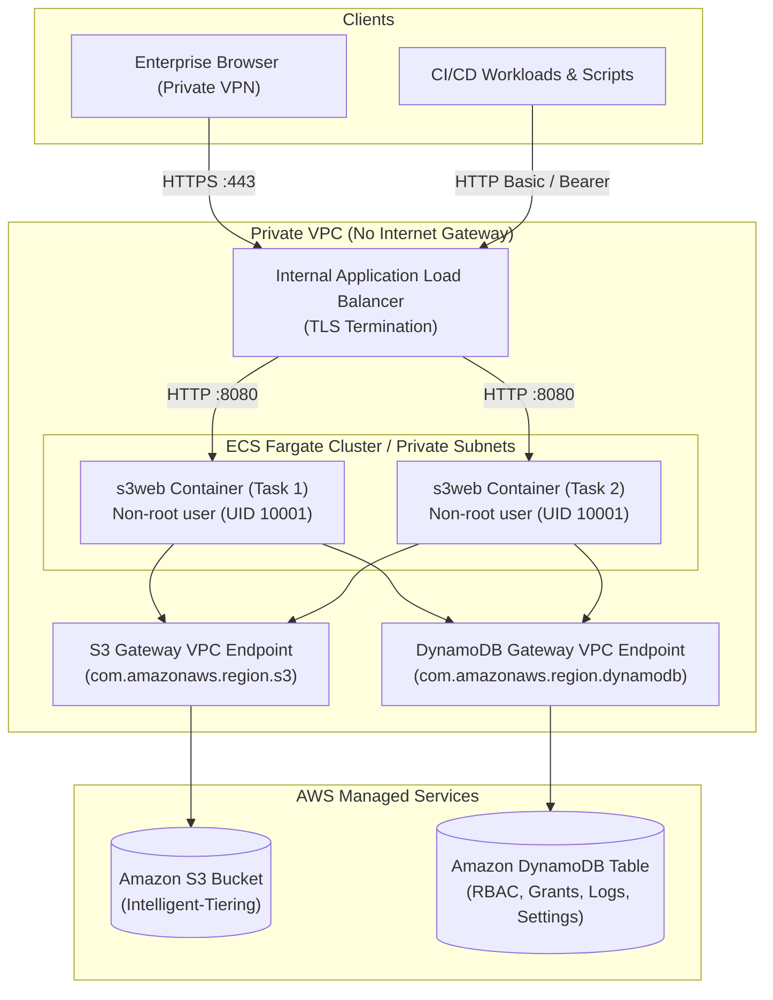

# s3web Installation & Deployment Guide

This guide describes how to build, configure, deploy, and operate `s3web` across local workstations, on-premise Linux virtual machines, Docker containers, and high-availability AWS ECS Fargate environments.

For operational administration and user guides, refer to:
- [Administrator Guide](file:///Users/jspencer/projects/s3web/docs/admin-guide.md)
- [User Guide](file:///Users/jspencer/projects/s3web/docs/user-guide.md)
- [S3 Authentication & Security Architecture](file:///Users/jspencer/projects/s3web/docs/s3-authentication.md)

---

## 1. Architecture & Topologies

`s3web` is packaged as a single self-contained Go binary with embedded web assets (`//go:embed`). It requires no runtime Node.js, Python, or external CDN connectivity, making it ideal for isolated enterprise VPCs and air-gapped data centers.

### Deployment Topologies



---

## 2. Prerequisites

### Build Environment
- **Go**: Version 1.22 or higher.
- **Git**: For source control checkouts.
- **Docker**: (Optional) For containerized packaging.
- **Terraform**: 1.5+ (Optional) For automated AWS ECS infrastructure provisioning.

### AWS Cloud Requirements (When running in AWS)
- **Amazon S3 Bucket**: Configured with S3 Intelligent-Tiering and default encryption (SSE-S3 or SSE-KMS).
- **Amazon DynamoDB Table**: For metadata, settings, local users, and audit logs (default table name: `s3web-metadata`).
- **IAM Task Role**: Attached to the ECS Task with scoped permissions to S3 and DynamoDB (no static keys).

---

## 3. Local & Bare-Metal Installation

### Building from Source

```bash
# Clone the repository
git clone https://github.com/example/s3web.git
cd s3web

# Build the native binary
go build -ldflags="-s -w" -o bin/s3web ./cmd/s3web

# Build for 64-bit Linux (production servers)
CGO_ENABLED=0 GOOS=linux GOARCH=amd64 go build -ldflags="-s -w" -o bin/s3web-linux-amd64 ./cmd/s3web

# Build for ARM64 Linux (AWS Graviton / Apple Silicon targets)
CGO_ENABLED=0 GOOS=linux GOARCH=arm64 go build -ldflags="-s -w" -o bin/s3web-linux-arm64 ./cmd/s3web
```

### Initial Standalone Run (Local Test Mode)

When run without AWS credentials or DynamoDB configured, `s3web` defaults to a local file-based data store under `~/.s3web/` or `/var/lib/s3web/`:

```bash
# Launch s3web locally on port 8080
./bin/s3web
```

On first startup, `s3web` will generate bootstrap credentials for the `admin` account and write them to `<S3WEB_LOCAL_DATA_DIR>/bootstrap-credentials.txt`:
```
========================================================================
 s3web Initial Bootstrap Credentials
========================================================================
 Admin Username: admin
 Admin Password: <generated-random-password>
 
 Service Account ID: svc-raw-access
 Service Account Token: svc-raw-access:s3w_<generated-random-token>
========================================================================
```

---

## 4. Systemd Service Configuration (Linux VM)

For bare-metal Linux servers or virtual machines running Ubuntu, Debian, RHEL, or Rocky Linux:

1. Create a dedicated service user and application directories:
   ```bash
   sudo useradd --system --shell /usr/sbin/nologin --create-home s3web
   sudo mkdir -p /var/lib/s3web /etc/s3web
   sudo chown -R s3web:s3web /var/lib/s3web /etc/s3web
   ```

2. Copy the binary:
   ```bash
   sudo install -m 0755 bin/s3web-linux-amd64 /usr/local/bin/s3web
   ```

3. Create the environment configuration file `/etc/s3web/s3web.env`:
   ```ini
   S3WEB_PORT=8080
   S3WEB_LISTEN_ADDR=0.0.0.0
   S3WEB_LOCAL_DATA_DIR=/var/lib/s3web
   S3WEB_S3_BUCKET=my-archive-bucket
   S3WEB_AWS_REGION=us-east-1
   S3WEB_ALLOWED_EXTENSIONS=.iso,.img,.tar.gz,.tgz,.zip,.qcow2,.raw
   S3WEB_TITLE=Enterprise File Archive
   S3WEB_ANONYMOUS_ACCESS=false
   ```

4. Create the systemd service file `/etc/systemd/system/s3web.service`:
   ```ini
   [Unit]
   Description=s3web Large File Archive Frontend
   After=network.target

   [Service]
   Type=simple
   User=s3web
   Group=s3web
   WorkingDirectory=/var/lib/s3web
   EnvironmentFile=/etc/s3web/s3web.env
   ExecStart=/usr/local/bin/s3web
   Restart=always
   RestartSec=5s
   LimitNOFILE=65536
   ProtectSystem=strict
   ProtectHome=yes
   ReadWritePaths=/var/lib/s3web

   [Install]
   WantedBy=multi-user.target
   ```

5. Enable and start the service:
   ```bash
   sudo systemctl daemon-reload
   sudo systemctl enable --now s3web
   sudo systemctl status s3web
   ```

---

## 5. Docker Container Deployment

### Building the Docker Image

The repository includes a multi-stage Docker build producing an unprivileged, minimal container image based on `scratch` or `alpine`:

```bash
docker build -t s3web:latest .
```

### Running with Docker

```bash
docker run -d \
  --name s3web \
  --restart unless-stopped \
  -p 8080:8080 \
  -v s3web-data:/data \
  -e S3WEB_PORT=8080 \
  -e S3WEB_LOCAL_DATA_DIR=/data \
  -e S3WEB_S3_BUCKET=my-archive-bucket \
  -e S3WEB_AWS_REGION=us-east-1 \
  -e S3WEB_ALLOWED_EXTENSIONS=.iso,.img,.tar.gz,.tgz,.zip,.qcow2,.raw \
  s3web:latest
```

Inspect bootstrap credentials:
```bash
docker exec s3web cat /data/bootstrap-credentials.txt
```

---

## 6. Production AWS Deployment via Terraform

The `terraform/` directory provides infrastructure-as-code for deploying `s3web` to an enterprise **Private VPC with AWS ECS Fargate**.

### Architecture Invariants
- **Zero Static AWS Credentials**: The container assumes an IAM Task Role via the ECS container agent. No static `AWS_ACCESS_KEY_ID` or `AWS_SECRET_ACCESS_KEY` are stored or injected.
- **Private VPC Only**: Subnets have no internet gateway routes. All traffic between `s3web` and AWS services travels via **VPC Gateway Endpoints** for S3 and DynamoDB.
- **Internal ALB**: TLS termination happens at an internal Application Load Balancer accessible only via corporate VPN or AWS Direct Connect.

### Deploying with Terraform

1. Ensure AWS CLI is authenticated:
   ```bash
   eval "$(aws configure export-credentials --format env)"
   ```

2. Navigate to `terraform/`:
   ```bash
   cd terraform
   ```

3. Initialize Terraform:
   ```bash
   terraform init
   ```

4. Create a `terraform.tfvars` file (do not commit this file to git):
   ```hcl
   vpc_id             = "vpc-0123456789abcdef0"
   private_subnet_ids = ["subnet-0123456789abcdef1", "subnet-0123456789abcdef2"]
   certificate_arn    = "arn:aws:acm:us-east-1:123456789012:certificate/abcdef-1234"
   s3_bucket_name     = "enterprise-large-file-archive"
   dynamodb_table     = "s3web-metadata"
   app_title          = "Corporate ISO & Archive Repository"
   ```

5. Review the plan and apply:
   ```bash
   terraform plan -out=tfplan
   terraform apply tfplan
   ```

6. Retrieve the initial admin password securely from AWS Secrets Manager:
   ```bash
   aws secretsmanager get-secret-value \
     --secret-id s3web-bootstrap-credentials \
     --query SecretString \
     --output text
   ```

---

## 7. Environment Variables Reference

`s3web` is configured via environment variables. All variables are prefixed with `S3WEB_`.

| Variable | Default | Description |
| :--- | :--- | :--- |
| `S3WEB_PORT` | `8080` | TCP port on which the HTTP server listens. |
| `S3WEB_LISTEN_ADDR` | `0.0.0.0` | IP address binding interface. |
| `S3WEB_LOCAL_DATA_DIR` | `./data` (or `~/.s3web`) | Path to local persistent store and bootstrap credential file. |
| `S3WEB_S3_BUCKET` | *(required)* | Name of the Amazon S3 bucket storing large file archives. |
| `S3WEB_AWS_REGION` | `us-east-1` | AWS region where the S3 bucket and DynamoDB table reside. |
| `S3WEB_DYNAMODB_TABLE` | `""` | DynamoDB table name for metadata and settings (if unset, uses local store). |
| `S3WEB_ALLOWED_EXTENSIONS` | `.iso,.img,.tar.gz,.tgz,.zip,.qcow2,.raw` | Comma-separated list of permitted upload file extensions. Use `*` to allow all. |
| `S3WEB_TITLE` | `s3web archive` | Branding title displayed in the Web UI and `/raw/` HTML autoindex headers. |
| `S3WEB_ANONYMOUS_ACCESS` | `false` | Enable or disable unauthenticated access to the repository (`true` or `false`). |
| `S3WEB_ENABLE_AUTOINDEX` | `true` | Enable Apache/Nginx-style HTML directory autoindex at `/raw/`. |
| `S3WEB_DEFAULT_TREE_EXPANDED` | `false` | Whether the Web UI folder tree defaults to expanded or collapsed. |
| `S3WEB_BOOTSTRAP_ADMIN_USERNAME` | `admin` | Username for the initial bootstrap administrator account. |
| `S3WEB_BOOTSTRAP_ADMIN_PASSWORD` | *(auto-generated)* | Initial admin password. If omitted, a secure 24-character random password is generated. |
| `S3WEB_BOOTSTRAP_RAW_ID` | `svc-raw-access` | Default service account ID for automated raw directory access. |
| `S3WEB_RESTORE_DEFAULT_DAYS` | `7` | Default duration in days for S3 Intelligent-Tiering archive restores. |
| `S3WEB_RESTORE_DEFAULT_TIER` | `Standard` | Retrieval tier for S3 restores (`Bulk`, `Standard`, `Expedited`). |
| `S3WEB_SLACK_WEBHOOK_URL` | `""` | Incoming Slack webhook URL for system notifications and restore completion alerts. |
| `S3WEB_SLACK_CHANNEL` | `""` | Default Slack channel name (e.g., `#archive-alerts`). |
| `S3WEB_SESSION_SECRET` | *(auto-generated)* | 32-byte secret used to sign secure session cookies. |

---

## 8. Health Checks & Verification

After starting `s3web`, verify service health:

### 1. Healthcheck Endpoint (`/healthz`)
```bash
curl -i http://localhost:8080/healthz
```
Expected response:
```http
HTTP/1.1 200 OK
Content-Type: application/json

{"status":"ok","version":"1.0.0"}
```

### 2. Swagger API Documentation (`/swagger/` and `/api/v1/openapi.json`)
Open `http://localhost:8080/swagger/` in your browser to inspect and interactively test all available API endpoints, or retrieve the raw OpenAPI 3.0 specification:
```bash
curl -s http://localhost:8080/api/v1/openapi.json | jq .info
```

### 3. Verify Admin Login
```bash
curl -s -c cookies.txt -X POST http://localhost:8080/api/v1/auth/login \
     -H "Content-Type: application/json" \
     -d '{"username":"admin","password":"<your-bootstrap-password>"}' | jq .
```

---

## 9. Backup, Maintenance & Disaster Recovery

- **DynamoDB Point-in-Time Recovery (PITR)**: Enable PITR on the metadata table (`S3WEB_DYNAMODB_TABLE`) to protect user accounts, access grants, and audit logs against accidental loss.
- **S3 Bucket Versioning & Intelligent-Tiering Lifecycle**: Ensure bucket versioning and Intelligent-Tiering transition rules are active to prevent object deletion accidents and optimize long-term storage costs.
- **Rotating Service Account Tokens**: Service account tokens can be revoked and re-generated at any time from **Admin** &rarr; **Service Accounts** without restarting the application service.

