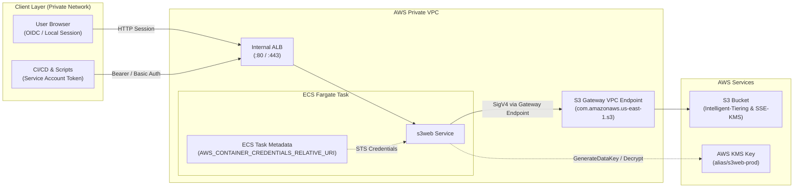
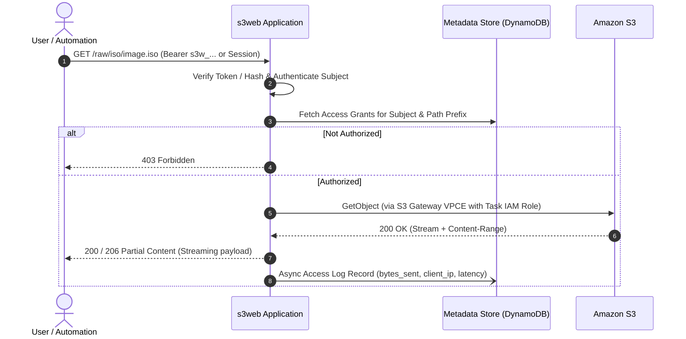

# S3 Authentication & Data-Plane Security Architecture

This document describes how `s3web` authenticates to Amazon S3 buckets, how IAM credentials are provisioned and scoped, how network boundaries are enforced, and how end-user access is decoupled from AWS IAM.

---

## 1. High-Level Architecture & Threat Model

`s3web` uses a **two-tier, zero-static-credential** authentication model:

1. **No Direct User Access to S3**: End users, CI/CD pipelines, and automated download scripts **never** receive direct AWS IAM credentials, STS temporary tokens, or presigned S3 URLs.
2. **Reverse-Proxy Streaming**: All artifact requests flow through `s3web`, which acts as an authorized gateway. The application evaluates in-app Role-Based Access Control (RBAC) and streams payloads directly to/from S3 while computing linear SHA-256 and SHA-1 checksums on the fly.
3. **No Hardcoded or Static AWS Credentials**: The `s3web` container holds no `AWS_ACCESS_KEY_ID` or `AWS_SECRET_ACCESS_KEY`. Temporary credentials are provided automatically by the AWS ECS Fargate runtime.
4. **Private Network Lockdown**: S3 traffic is restricted to the internal VPC and never traverses the public internet.



---

## 2. AWS IAM Task Role Authentication

In production on AWS ECS Fargate, `s3web` authenticates to S3 using the **ECS Task IAM Role**.

### Credential Resolution Flow
1. When the container initializes, the AWS SDK contacts the local container metadata link (`169.254.170.2$AWS_CONTAINER_CREDENTIALS_RELATIVE_URI`).
2. AWS ECS returns temporary AWS Security Token Service (STS) credentials (`AccessKeyId`, `SecretAccessKey`, `SessionToken`) associated with `s3web-prod-ecs-task-role`.
3. Credentials rotate automatically before expiry without interrupting running file transfers.

### Least-Privilege IAM Policy
The ECS Task Role is granted only the exact S3 and KMS permissions required to manage artifacts and compute hashes:

```json
{
  "Version": "2012-10-17",
  "Statement": [
    {
      "Sid": "S3ArtifactBucketAccess",
      "Effect": "Allow",
      "Action": [
        "s3:ListBucket",
        "s3:GetBucketLocation",
        "s3:GetObject",
        "s3:GetObjectVersion",
        "s3:GetObjectAttributes",
        "s3:PutObject",
        "s3:DeleteObject",
        "s3:RestoreObject",
        "s3:AbortMultipartUpload",
        "s3:ListMultipartUploadParts"
      ],
      "Resource": [
        "arn:aws:s3:::s3web-iso-artifacts-283327683538-us-east-1",
        "arn:aws:s3:::s3web-iso-artifacts-283327683538-us-east-1/*"
      ]
    },
    {
      "Sid": "KMSDataKeyAccess",
      "Effect": "Allow",
      "Action": [
        "kms:Encrypt",
        "kms:Decrypt",
        "kms:ReEncrypt*",
        "kms:GenerateDataKey*",
        "kms:DescribeKey"
      ],
      "Resource": "arn:aws:kms:us-east-1:283327683538:key/ea70eec3-a862-40fe-ae46-4f7cf8241ad6"
    }
  ]
}
```

*Terraform source: `terraform/compute_and_alb.tf` (`aws_iam_role.ecs_task`).*

---

## 3. S3 Bucket Policy & Network Perimeter Enforcement

Even with valid IAM credentials, access to the S3 bucket is blocked unless requests originate from inside the VPC.

### 1. Zero-Cost Gateway VPC Endpoint
- S3 requests from ECS tasks route through an **AWS Gateway VPC Endpoint** (`com.amazonaws.<region>.s3`) associated with the private route tables.
- Eliminates NAT Gateway data-processing fees ($0.045/GB) for multi-gigabyte ISO, virtual disk image, and archive transfers.

### 2. S3 Bucket Policy Lockdown
The bucket policy enforces:
1. **Mandatory TLS**: Rejects unencrypted (`http://`) requests.
2. **VPC Endpoint Restriction**: Rejects data operations (`GetObject`, `PutObject`, `DeleteObject`) unless the request passes through the VPC S3 Gateway Endpoint ID (`aws:SourceVpce`) and originates from the ECS Task IAM Role.

```json
{
  "Version": "2012-10-17",
  "Statement": [
    {
      "Sid": "DenyNonTLSRequests",
      "Effect": "Deny",
      "Principal": "*",
      "Action": "s3:*",
      "Resource": [
        "arn:aws:s3:::s3web-iso-artifacts-283327683538-us-east-1",
        "arn:aws:s3:::s3web-iso-artifacts-283327683538-us-east-1/*"
      ],
      "Condition": {
        "Bool": { "aws:SecureTransport": "false" }
      }
    },
    {
      "Sid": "DenyObjectAccessOutsideVPCGatewayEndpoint",
      "Effect": "Deny",
      "Principal": "*",
      "Action": [
        "s3:GetObject*",
        "s3:PutObject*",
        "s3:DeleteObject*"
      ],
      "Resource": "arn:aws:s3:::s3web-iso-artifacts-283327683538-us-east-1/*",
      "Condition": {
        "StringNotEquals": {
          "aws:SourceVpce": "vpce-098a746ddb98e83dd"
        },
        "ArnNotEquals": {
          "aws:PrincipalArn": [
            "arn:aws:iam::283327683538:role/s3web-prod-ecs-task-role",
            "arn:aws:iam::283327683538:root"
          ]
        }
      }
    }
  ]
}
```

*Terraform source: `terraform/storage_and_db.tf` (`aws_s3_bucket_policy.artifacts`).*

---

## 4. Application-Layer RBAC & Decoupled Access

Because clients never touch AWS S3 directly, `s3web` provides fine-grained, in-app authentication and prefix authorization:

| Client Type | Authentication Mechanism | Authorization Check |
| :--- | :--- | :--- |
| **Browser User (SSO)** | OIDC Authorization Code Flow (Google Workspace, Okta, Keycloak) | Mapped to In-App AppGroups & Access Grants |
| **Local Admin / User** | PBKDF2-HMAC-SHA256 hashed password via Cookie Session | Checked against Local Account record |
| **Automation & Scripts** | Service Account Token (`Authorization: Bearer <id>:s3w_<secret>`) or HTTP Basic Auth | Checked against Service Account Grants |

### Request Authorization Sequence



---

## 5. Storage Layer Interface in Go

In the codebase, object storage is abstracted behind the [`ObjectStorage`](../internal/storage/storage.go) interface:

```go
type ObjectStorage interface {
    PutStream(ctx context.Context, key string, r io.Reader, contentType string) (*PutResult, error)
    GetStream(ctx context.Context, key string, rangeHeader string) (*GetResult, error)
    Delete(ctx context.Context, key string) error
    Restore(ctx context.Context, key string, days int) error
}
```

- **Local Storage Implementation**: [`LocalFSStorage`](../internal/storage/storage.go) emulates S3 behavior locally for development and offline testing.
- **S3 Storage Implementation**: When integrating the AWS Go SDK (`aws-sdk-go-v2/service/s3`), `config.LoadDefaultConfig(ctx)` discovers the ECS container metadata credentials automatically. No custom credential provider or configuration file is required.

